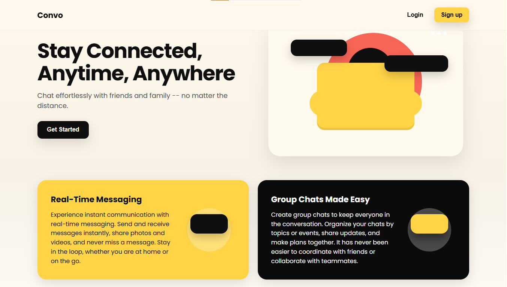
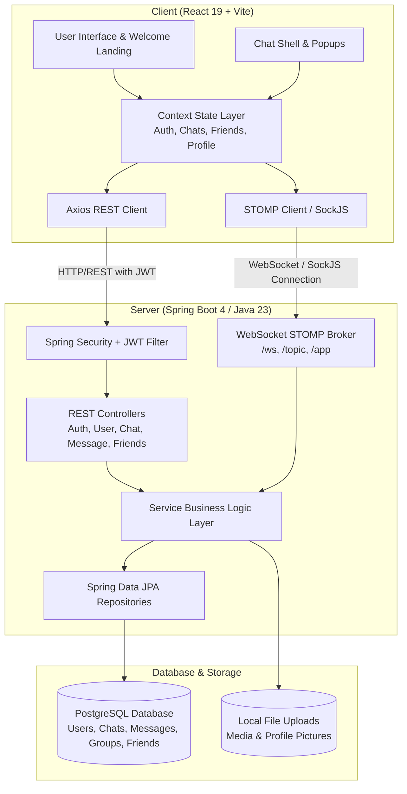

# Convo

<p align="center">
  <strong style="font-size: 1.25rem;">A quick, simple, and trustworthy way for friends to stay connected.</strong>
</p>

<p align="center">
  
  
  
  
  
  
</p>

---

<!-- ========================================================================= -->
<!--                           WELCOME PAGE PREVIEW                            -->
<!-- ========================================================================= -->

## 📸 Welcome Page Preview


<p align="center">
  <a href="#convo">
    <h3>🖼️ [Welcome Page Screenshot Placeholder]</h3><p>Drop your welcome page screenshot in <code>docs/images/welcome-page.png</code> to preview it here.</p></div>';"
    />
  </a>
</p>

<p align="center">
  <em>The modern, vibrant Convo welcome experience — built with warm amber tones, organic geometry, and seamless authentication.</em>
</p>

---

## 🌟 Overview

**Convo** is a full-stack, real-time messaging and social connectivity web application engineered for speed, simplicity, and delightful conversations. Designed with an amber-and-obsidian visual language, Convo eliminates interface clutter so you can focus on what matters most: staying close with friends, family, and collaborative groups.

Whether exchanging instant direct messages, organizing multi-member group channels, or discovering new connections via the **Social Radar**, Convo delivers a fluid, responsive experience across devices.

---

## 🎨 Design Philosophy & Aesthetic System

Convo embraces a distinctive visual identity that pairs high contrast with warm, welcoming accents:

- **Warm Amber & Obsidian Palette**: Anchored by `#ffd447` (vibrant sunshine yellow), `#fff8ed` (warm light-mode canvas), and `#0f0f0f` (deep obsidian accent), striking a balance between energetic playfulness and professional focus.
- **Glassmorphism & Soft Elevation**: Subtle multi-layered box shadows (`rgba(0, 0, 0, 0.12)`) and translucent glass overlays (`rgba(255, 255, 255, 0.82)`) provide visual depth without heavy borders.
- **Organic Geometry**: Generous border radiuses (`12px` to `28px`) impart a friendly, approachable touch across interactive buttons, cards, avatars, and input bubbles.
- **Refined Typography**: Styled with the modern geometric sans-serif **Poppins** from Google Fonts, ensuring crisp readability across message bubbles and sidebar navigation.

### 📐 User Interface Layout

Convo’s interface is split into two primary experiences:

1. **The Welcome Experience (`/welcome`)**:
   - **Hero Canvas**: Engaging tagline and call-to-action with animated illustration elements and sparkles.
   - **Feature Showcase**: Bold contrasting panels detailing real-time communication capabilities and group management.
   - **Integrated Auth Modal**: Minimalist, frictionless popup for Login and Signup with instant validation.

2. **The Chat Shell (`/chat`)**:
   - **Side Navigation Panel (Left)**:
     - Header with brand logo, Quick Search, Social Radar, and Settings triggers.
     - Segmented navigation tabs: **Chats**, **Friends**, and **Groups**.
     - Real-time conversation stream with unread status, timestamps, and active badges.
     - Current user profile footer with quick avatar access.
   - **Chat Window (Center)**:
     - Conversation header with contact/group details and drawer toggle.
     - Smooth-scrolling message canvas with visual sender distinction, relative timestamps (`date-fns`), and optimistic rendering.
     - Rich message composer featuring file attachment capabilities (`FaPaperclip`), emoji picker integration, and rapid send shortcuts.
   - **Contextual Info Panel (Right)**:
     - Expandable drawer presenting participant rosters, group descriptions, member counts, and shared media files.
   - **Action Modals (PopUp Layer)**:
     - **Social Radar**: Manage pending friend requests (Accept / Reject) in real time.
     - **User Search**: Search registered users across the platform and send instant friend requests.
     - **Create Group**: Multi-select friends, assign channel names and descriptions, and launch collaborative spaces.
     - **Settings & Profile**: Manage personal user details and initiate secure logout.

---

## ⚡ Key Features

- **⚡ Instant Real-Time Messaging**: Low-latency duplex messaging powered by **Spring WebSocket** and **STOMP protocol** over **SockJS**.
- **👥 1-on-1 & Group Chats**: Seamless switching between private direct messages and multi-member team/group channels.
- **🎯 Social Radar & Friendship System**:
  - Global user discovery by username and name.
  - Interactive friend request lifecycle (`PENDING`, `ACCEPTED`, `REJECTED`, `CANCELLED`).
  - Dedicated friends tab for instant chat initiation.
- **📎 Multi-Format Media & Attachments**: Architecture ready for photos, video, audio, and documents with dedicated file metadata tracking.
- **🛡️ Robust Security & Authentication**:
  - Stateless JSON Web Token (**JWT**) authentication.
  - Spring Security request filtering and password encryption.
  - Protected client routes with automatic session expiry handling.
- **🎭 Multi-Layer State Architecture**: React Context providers (`AuthContext`, `ProfileContext`, `FriendsContext`, `ChatsContext`, `SelectedChatContext`, `PopUpContext`, `InfoDisplayContext`) ensuring decoupled, predictable state flow.

---

## 🏗️ System Architecture



---

## 🛠️ Technology Stack

| Layer | Technology | Description |
| :--- | :--- | :--- |
| **Frontend Framework** | [React 19](https://react.dev/) | Component-driven UI library with modern Hooks |
| **Build Tooling** | [Vite 7](https://vitejs.dev/) | High-speed frontend dev server and bundler |
| **Routing** | [React Router v7](https://reactrouter.com/) | Client-side routing and protected view transitions |
| **Real-Time Client** | [SockJS-Client](https://github.com/sockjs/sockjs-client) & [StompJS](https://github.com/stomp-js/stompjs) | WebSocket fallback abstraction and STOMP message protocol |
| **Icons & Utility** | [React Icons](https://react-icons.github.io/react-icons/) & [date-fns](https://date-fns.org/) | Vector icon sets and modern date formatting |
| **Backend Framework** | [Spring Boot 4.0.1](https://spring.io/projects/spring-boot) | Enterprise Java application framework |
| **Language & Toolchain** | [Java 23](https://openjdk.org/projects/jdk/23/) & [Gradle](https://gradle.org/) | Modern Java runtime with Gradle build automation |
| **Persistence & ORM** | [Spring Data JPA](https://spring.io/projects/spring-data-jpa) & [Hibernate](https://hibernate.org/) | Relational object-relational mapping |
| **Database** | [PostgreSQL 42](https://www.postgresql.org/) | Robust, production-grade relational database |
| **Security & Auth** | [Spring Security](https://spring.io/projects/spring-security) & [io.jsonwebtoken (JJWT)](https://github.com/jwtk/jjwt) | Stateless JWT authorization and password encryption |

---

## 📁 Repository Structure

```text
Convo/
├── Client/                         # Frontend React + Vite Application
│   ├── public/                     # Static assets and favicons
│   ├── src/
│   │   ├── components/             # Global reusable components (e.g., ProtectedRoute)
│   │   ├── contexts/               # Root Context Providers (Auth, Profile, Friends, Chats)
│   │   ├── hooks/                  # Custom application hooks
│   │   ├── pages/
│   │   │   ├── Welcome/            # Public Welcome / Landing experience
│   │   │   │   ├── components/     # Home, About, Features, NavBar, AuthModal, Footer
│   │   │   │   ├── Welcome.css     # Landing page styles
│   │   │   │   └── Welcome.jsx     # Welcome route layout
│   │   │   └── ChatShell/          # Main authenticated messaging workspace
│   │   │       ├── components/     # SidePanel, ChatWindow, InfoPanel, PopUp
│   │   │       ├── contexts/       # Shell-specific Contexts (SelectedChat, PopUp, etc.)
│   │   │       └── ChatShell.jsx   # Tri-pane layout container
│   │   ├── services/               # API & WebSocket client services
│   │   ├── App.css                 # Design token palette and global CSS variables
│   │   ├── App.jsx                 # Provider composition and route definitions
│   │   ├── index.css               # Core base styles
│   │   └── main.jsx                # Application root entrypoint
│   ├── .env                        # Client environment configuration
│   └── package.json                # Frontend dependencies and npm scripts
│
├── Server/                         # Backend Spring Boot Application
│   ├── src/
│   │   ├── main/
│   │   │   ├── java/org/convo/     # Controllers, Models, Repositories, Services, Config
│   │   │   └── resources/
│   │   │       ├── application.properties  # Server ports, DB credentials, JWT secrets
│   │   │       └── schema.sql              # PostgreSQL DDL schema & table definitions
│   ├── uploads/                    # Local storage directory for media attachments
│   ├── build.gradle                # Gradle build script and dependency declarations
│   └── gradlew                     # Gradle wrapper executable
│
└── README.md                       # Project overview and documentation
```

---

## 🚀 Getting Started

Follow these instructions to set up and run Convo locally on your machine.

### Prerequisites

Ensure you have installed:
- **Node.js** (v18.x or later) & **npm**
- **Java Development Kit (JDK)**: Java 23
- **PostgreSQL**: Running instance on `localhost:5432`

---

### 1. Database Setup

Create a PostgreSQL database named `ConvoDB`:

```sql
CREATE DATABASE "ConvoDB";
```

*(Optional)* You can execute `Server/schema.sql` to inspect or manually verify table definitions and performance indexes.

---

### 2. Backend Setup (`Server`)

1. Navigate to the server folder:
   ```bash
   cd Server
   ```

2. Verify or update `src/main/resources/application.properties` with your PostgreSQL credentials:
   ```properties
   spring.datasource.url=jdbc:postgresql://localhost:5432/ConvoDB
   spring.datasource.username=postgres
   spring.datasource.password=your_password
   ```

3. Build and launch the Spring Boot application:
   ```bash
   # On macOS/Linux:
   ./gradlew bootRun

   # On Windows:
   gradlew.bat bootRun
   ```

The backend API will start on `http://localhost:8080`, and the WebSocket broker will listen at `ws://localhost:8080/ws`.

---

### 3. Frontend Setup (`Client`)

1. Open a new terminal and navigate to the client folder:
   ```bash
   cd Client
   ```

2. Ensure your `.env` points to the local backend:
   ```env
   VITE_API_BASE_URL=http://localhost:8080
   VITE_WS_BASE_URL=http://localhost:8080/ws
   ```

3. Install project dependencies:
   ```bash
   npm install
   ```

4. Start the Vite development server:
   ```bash
   npm run dev
   ```

5. Open your browser and navigate to:
   ```text
   http://localhost:5173
   ```

---

## 💬 WebSocket Message Flow

Convo uses STOMP over SockJS for bi-directional real-time communication:

- **Connect URL**: `/ws` (with JWT authentication headers)
- **Topic Subscriptions**:
  - `/topic/chat/{chatId}`: Delivers incoming chat messages, edit updates, and media notifications.
  - `/topic/user/{userId}/requests`: Delivers real-time incoming and accepted friend requests.
- **Message Dispatch Destination**:
  - `/app/chat.sendMessage`: Routes outgoing messages to participants via server persistence.

---

## 🤝 Contributing

Contributions are welcome! If you'd like to improve Convo:

1. Fork the repository.
2. Create your feature branch: `git checkout -b feature/amazing-feature`.
3. Commit your changes: `git commit -m "Add amazing feature"`.
4. Push to the branch: `git push origin feature/amazing-feature`.
5. Open a Pull Request.

---

## 📄 License

This project is open-source and available under the [MIT License](LICENSE).
